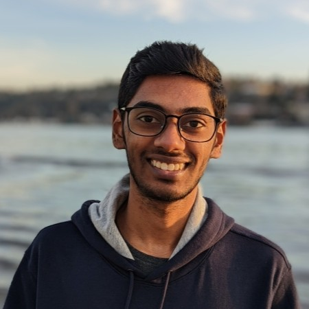

::: {.text-center style="margin-top: 20px;"}



[**Srivatsan Balaji**]{.hero-name}

[Research & Development Intern/Contributor\
Nimble Surgical]{.affiliation}

[Interests: Soft and Materials Robotics]{.italic-text}

<a href="cv/CV_SrivatsanBalaji.pdf" target="_blank" style="text-decoration: none; font-weight: 700;"><svg class="nav-icon" aria-hidden="true" fill="currentColor" xmlns="http://www.w3.org/2000/svg" viewBox="0 0 384 512"><path d="M0 64C0 28.7 28.7 0 64 0L224 0l0 128c0 17.7 14.3 32 32 32l128 0 0 288c0 35.3-28.7 64-64 64L64 512c-35.3 0-64-28.7-64-64L0 64zm384 64l-128 0L256 0 384 128z"/></svg>&nbsp; [View CV]{.bold}</a>

:::

::: {.justify style="margin: 50px 0;"}

I am contributing to develop metamaterial-based tip-transforming catheters at Nimble Surgical.
Previously, I was a Faculty Research Assistant in the Intelligent Machines and Materials Lab, part of Collaborative Robotics and Intelligent Systems (CoRIS) Institute at Oregon State University.
I developed hardware for integrating flexible sensors for augmenting human-supervised underwater grasping. Prior to this, I built and characterized soft grippers and robot arm,
and 

My work sits at the intersection of mechanical engineering, robotics, materials, and computation to some extent.
I design the system, fabricate it, characterize, then feed what I learned back into the design.

Outside of work, I am a virtual pilot and hobbyist photographer.

Read more about my work on the [research](research.html) page.

```{=html}
<!-- flow chart disabled for now
<section class="work" aria-label="How I work">
  <p class="work__intro">One loop does most of my work. I design the system, fabricate it, characterize the material and system, then feed what I learned back into the design.</p>


  <div class="work__loop">
    <ol class="work__stages">
      <li class="work__stage">
        <span class="work__num">01</span>
        <b class="work__stage-title">Design</b>
        <span class="work__stage-main">SolidWorks, Autodesk Fusion 360</span>
        <span class="work__stage-sub">Design and development of soft robotic systems and end effectors</span>
      </li>
      <li class="work__stage">
        <span class="work__num">02</span>
        <b class="work__stage-title">Fabricate</b>
        <span class="work__stage-main">Fused deposition modeling, stereolithography, material jetting, silicone casting</span>
      </li>
      <li class="work__stage">
        <span class="work__num">03</span>
        <b class="work__stage-title">Characterize</b>
        <span class="work__stage-main">Mechanical analysis and characterization</span>
        <span class="work__stage-sub">Of the materials and of the finished systems</span>
      </li>
      <li class="work__stage">
        <span class="work__num">04</span>
        <b class="work__stage-title">Compute</b>
        <span class="work__stage-main">Python, MATLAB, SOFA Framework</span>
        <span class="work__stage-sub">Simulation, data processing, analysis, and feedback</span>
      </li>
    </ol>
    <div class="work__feedback"><span class="work__label">results feed the next design</span></div>
  </div>

  <div class="work__link"><span class="work__label">produces</span></div>

  <div class="work__hardware">
    <b class="work__hardware-title">Functional hardware</b>
    <span class="work__stage-main">Soft grippers, robot arms, end effectors, and devices</span>
  </div>

  <div class="work__link work__link--fan"><span class="work__label">applied to</span></div>

  <ul class="work__cards" aria-label="Research focus areas">
    <li class="work__card">
      <b class="work__card-title">High-Payload Soft Robots</b>
      <span class="work__card-detail">Soft robots are safe and adaptable, but their compliant bodies can twist or buckle under load. I used torsion-resistant structures to preserve compliance while carrying useful payloads.</span>
    </li>
    <li class="work__card">
      <b class="work__card-title">Underwater Manipulation</b>
      <span class="work__card-detail">Operators lose reliable visual feedback in turbulent, low-visibility conditions at depth. I integrated flexible tactile sensors onto existing hardware to help assess grasp stability.</span>
    </li>
    <li class="work__card">
      <b class="work__card-title">Agricultural Robots</b>
      <span class="work__card-detail">Soft fruit picking is a narrow force-control problem: too much damages the fruit, and too little lets it slip. I built sensorized grippers that generate useful grasp data to teach robots.</span>
    </li>
    <li class="work__card">
      <b class="work__card-title">Advanced Guide Catheters</b>
      <span class="work__card-detail">Developing tools to accelerate the design of HSA-based anchoring guide catheters.</span>
    </li>
  </ul>
</section>
-->
```

<style>
/* ── Work: design → fabricate → characterize → compute loop ── */
.work {
  --gold: #d9b95a;
  --line: #a08a4a;
  --gap: clamp(32px, 4vw, 56px);
  --card-gap: clamp(14px, 1.8vw, 24px);
  --pad: clamp(14px, 1.8vw, 24px);
  --node-bg: #080808;
  --node-border: #262626;
  margin: 48px 0 8px;
  text-align: left;
  color: #e4e1d8;
}
/* Same text width as the Research page (989px), centered since About has no TOC. */
main.content { max-width: 989px; margin-inline: auto; }
.work__intro {
  max-width: none;
  margin: 0 0 2rem;
  color: inherit;
}
.work__label {
  font-size: 0.95rem;
  line-height: 1.35;
  font-style: italic;
  color: #b9a671;
}

/* loop panel */
.work__loop {
  padding: clamp(16px, 2.2vw, 32px) clamp(16px, 2.2vw, 32px) 0;
  background: #050505;
  border: 1px solid #26231a;
  border-radius: 20px;
}
.work__stages {
  display: grid;
  grid-template-columns: repeat(4, 1fr);
  column-gap: var(--gap);
  margin: 0;
  padding: 0;
  list-style: none;
}
.work__stage,
.work__hardware,
.work__card {
  display: flex;
  flex-direction: column;
  box-sizing: border-box;
  padding: var(--pad);
  background: var(--node-bg);
  border: 1px solid var(--node-border);
  border-radius: 12px;
}
.work__stage {
  position: relative;
  min-height: 248px;
  border-left: 2px solid var(--gold);
}
.work__num {
  font-size: 0.875rem;
  letter-spacing: 0.14em;
  color: var(--gold);
}
.work__stage-title {
  font-size: clamp(1.25rem, 1.8vw, 1.5rem);
  line-height: 1.5;
  font-weight: 600;
  color: #f5f3ee;
}
.work__stage-main { font-size: 1rem; line-height: 1.5; color: #e4e1d8; }
.work__stage-sub  { font-size: 0.94rem; line-height: 1.45; color: #b8b5aa; }

/* arrow between stages */
.work__stage:not(:last-child)::before {
  content: "";
  position: absolute;
  top: 50%;
  left: calc(100% + 1px);
  width: calc(var(--gap) - 6px);
  height: 2px;
  margin-top: -1px;
  background: var(--line);
}
.work__stage:not(:last-child)::after {
  content: "";
  position: absolute;
  top: 50%;
  left: calc(100% + var(--gap) - 8px);
  margin-top: -4px;
  border: 4px solid transparent;
  border-left: 8px solid var(--line);
  border-right: 0;
}

/* feedback loop: from the centre of Compute back to the centre of Design */
.work__feedback {
  position: relative;
  height: 48px;
  margin: 0 calc((100% - 3 * var(--gap)) / 8) 56px;
  border: 2px solid var(--line);
  border-top: 0;
}
.work__feedback::before {
  content: "";
  position: absolute;
  top: -2px;
  left: -5px;
  border: 4px solid transparent;
  border-bottom: 8px solid var(--line);
  border-top: 0;
}
.work__feedback .work__label {
  position: absolute;
  top: calc(100% + 10px);
  left: 50%;
  transform: translateX(-50%);
  white-space: nowrap;
}

/* vertical connectors */
.work__link {
  position: relative;
  width: 2px;
  height: 64px;
  margin: 0 auto;
  background: var(--line);
}
.work__link::after {
  content: "";
  position: absolute;
  bottom: -1px;
  left: -4px;
  border: 4px solid transparent;
  border-top: 8px solid var(--line);
  border-bottom: 0;
}
.work__link .work__label {
  position: absolute;
  top: 50%;
  left: 18px;
  transform: translateY(-50%);
  white-space: nowrap;
}
.work__link--fan { height: 48px; }
.work__link--fan::after { display: none; }

.work__hardware {
  max-width: 560px;
  margin: 0 auto;
  justify-content: center;
  min-height: 112px;
  background: #0b0a06;
  border-color: var(--line);
}
.work__hardware-title {
  font-size: clamp(1.25rem, 1.8vw, 1.5rem);
  line-height: 1.4;
  font-weight: 600;
  color: #f5f3ee;
}

/* focus cards, fed by a fan-out of arrows */
.work__cards {
  position: relative;
  display: grid;
  grid-template-columns: repeat(4, 1fr);
  gap: var(--card-gap);
  margin: 48px 0 0;
  padding: 0;
  list-style: none;
}
.work__cards::before {
  content: "";
  position: absolute;
  top: -48px;
  left: calc((100% - 3 * var(--card-gap)) / 8);
  right: calc((100% - 3 * var(--card-gap)) / 8);
  height: 2px;
  margin-top: -1px;
  background: var(--line);
}
.work__card {
  position: relative;
  gap: 0.2rem;
}
.work__card::before {
  content: "";
  position: absolute;
  top: -48px;
  left: 50%;
  width: 2px;
  height: 47px;
  margin-left: -1px;
  background: var(--line);
}
.work__card::after {
  content: "";
  position: absolute;
  top: -9px;
  left: 50%;
  margin-left: -4px;
  border: 4px solid transparent;
  border-top: 8px solid var(--line);
  border-bottom: 0;
}
.work__card-title {
  font-size: clamp(1.1rem, 1.6vw, 1.375rem);
  line-height: 1.45;
  font-weight: 600;
  color: #f5f3ee;
}
.work__card-detail {
  font-size: 1rem;
  line-height: 1.5;
  color: #b8b5aa;
}

/* ── Responsive: stack vertically with simple down arrows ── */
@media (max-width: 900px) {
  .work { --gap: 40px; }
  .work__loop { padding-bottom: clamp(16px, 2.2vw, 32px); }
  .work__stages { grid-template-columns: 1fr; }
  .work__stage { min-height: 0; }
  .work__stage:not(:last-child)::before {
    top: 100%;
    left: 50%;
    width: 2px;
    height: calc(var(--gap) - 6px);
    margin: 1px 0 0 -1px;
  }
  .work__stage:not(:last-child)::after {
    top: calc(100% + var(--gap) - 8px);
    left: 50%;
    margin: 0 0 0 -4px;
    border: 4px solid transparent;
    border-top: 8px solid var(--line);
    border-bottom: 0;
  }
  .work__feedback {
    height: auto;
    margin: 20px 0 0;
    border: 0;
    text-align: center;
  }
  .work__feedback::before { display: none; }
  .work__feedback .work__label {
    position: static;
    display: block;
    transform: none;
    white-space: normal;
  }
  .work__link { height: 48px; }
  .work__link--fan { height: 48px; }
  .work__link--fan::after { display: block; }
  .work__cards { grid-template-columns: 1fr; margin-top: 16px; }
  .work__cards::before,
  .work__card::before,
  .work__card::after { display: none; }
}
</style>

:::
