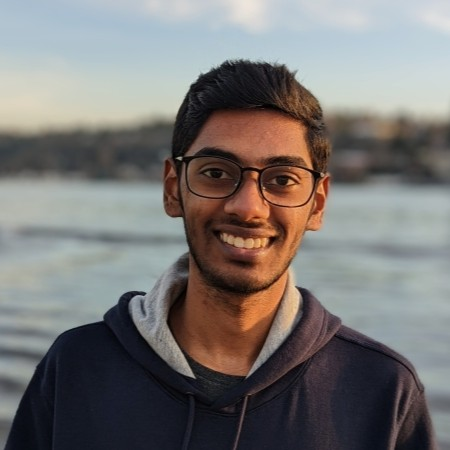

::: {.text-center style="margin-top: 20px;"}

[**Srivatsan Balaji**]{.hero-name}

[Research & Development Intern/Contributor\
Nimble Surgical]{.affiliation}

[Interests: Soft and Materials Robotics]{.italic-text}

<a href="cv/CV_SrivatsanBalaji.pdf" target="_blank" rel="noopener" style="text-decoration: none; font-weight: 500;"><svg class="nav-icon" aria-hidden="true" fill="currentColor" xmlns="http://www.w3.org/2000/svg" viewBox="0 0 384 512"><path d="M0 64C0 28.7 28.7 0 64 0L224 0l0 128c0 17.7 14.3 32 32 32l128 0 0 288c0 35.3-28.7 64-64 64L64 512c-35.3 0-64-28.7-64-64L0 64zm384 64l-128 0L256 0 384 128z"/></svg>&nbsp; View CV</a>

:::

::: {.justify style="margin: 50px 0;"}

I am contributing to the development of metamaterial-based tip-transforming catheters at Nimble Surgical.
Previously, I was a Faculty Research Assistant in the Intelligent Machines and Materials Lab, part of the Collaborative Robotics and Intelligent Systems (CoRIS) Institute at Oregon State University.
I developed hardware for integrating flexible sensors for augmenting human-supervised underwater grasping. Prior to this, I built and characterized electrically-driven soft grippers and a robot arm,
and improved the performance of Pneu-Net actuators.

My work sits at the intersection of mechanical engineering, robotics, materials, and computation to some extent.
I design the system, fabricate it, characterize it, then feed what I learned back into the design.

Outside of work, I am a virtual pilot and hobbyist photographer.

Read more about my work on the [research](research.html) page.

:::
