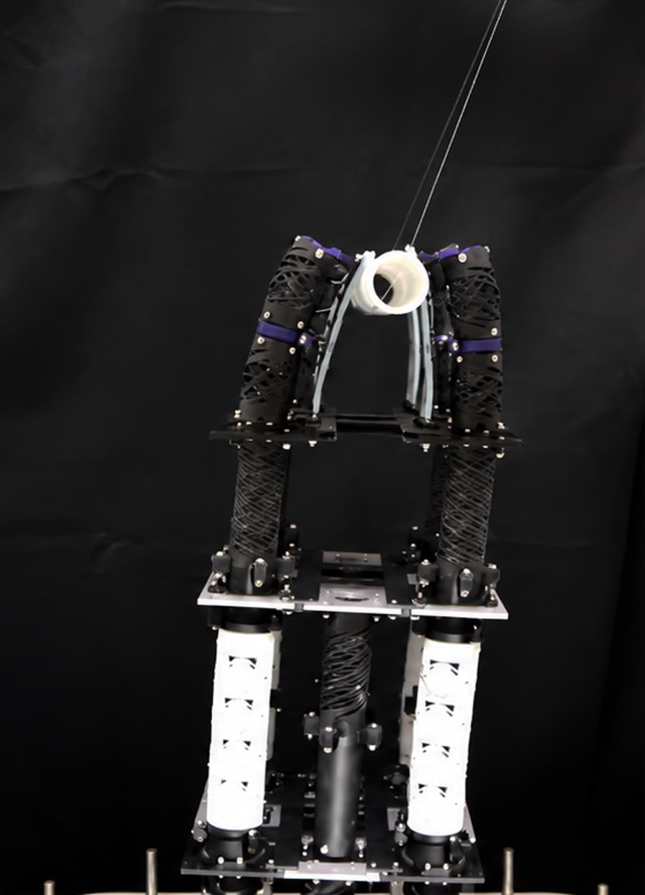
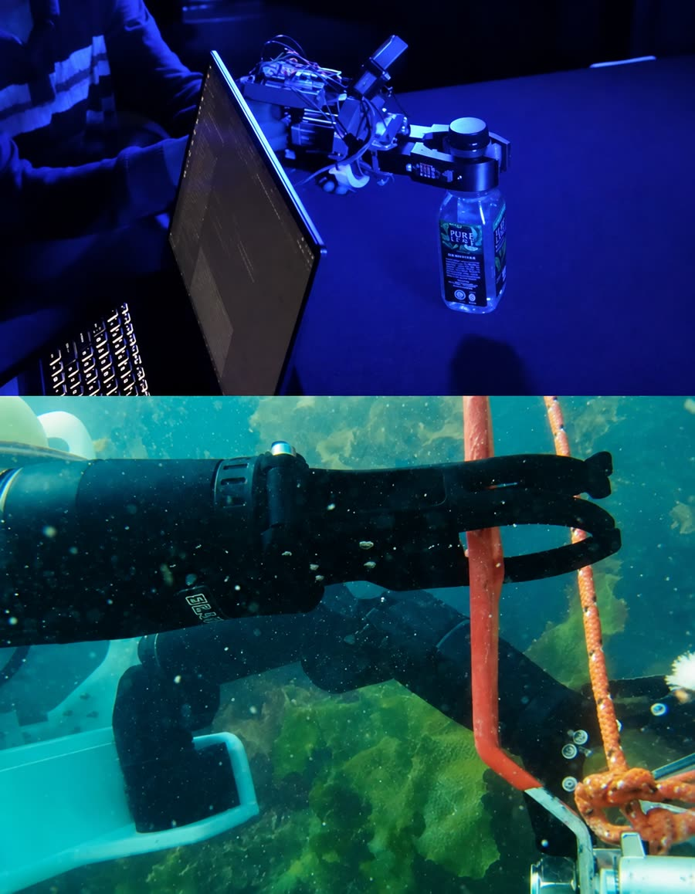
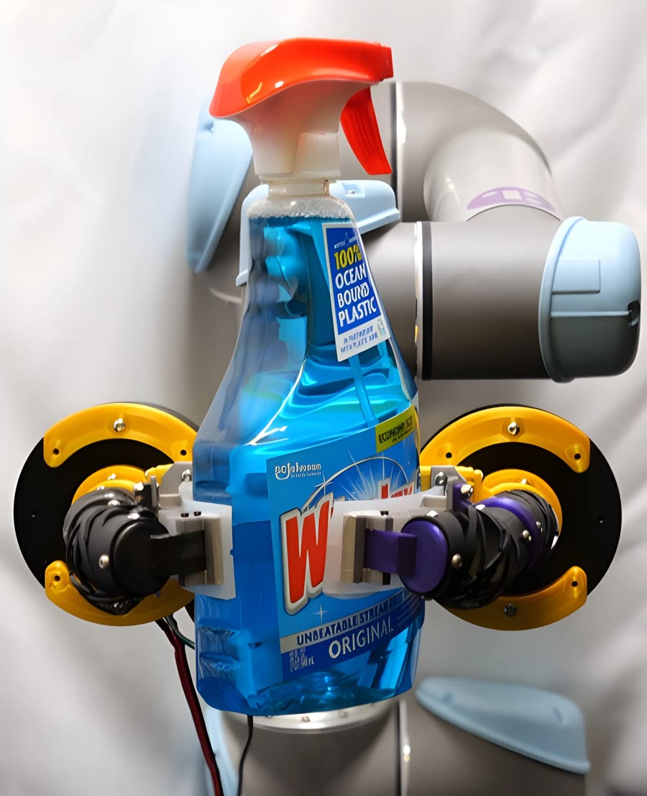

<!-- <div id="constellation-bg" aria-hidden="true"></div> -->

<style>
html { background: #000000; }
body,
header#quarto-header,
#quarto-header .navbar,
#quarto-content,
#quarto-document-content,
.quarto-container,
.page-columns,
main.content,
.navbar-container,
.quarto-title-block {
  background: transparent !important;
}
#constellation-bg {
  position: fixed;
  inset: 0;
  z-index: -1;
  pointer-events: none;
}
#quarto-header .navbar {
  box-shadow: 0 1px 0 rgba(255,255,255,0.06);
}
/* The glow extends past the right edge; clip it so it cannot add a horizontal scrollbar. */
html, body { overflow-x: clip; }
.home-hero {
  display: grid;
  grid-template-columns: 1fr 1fr;
  gap: 56px;
  align-items: center;
  margin-top: 40px;
}
.home-headline {
  text-align: left;
  font-weight: 400;
  font-size: clamp(1.8rem, 3vw, 2.6rem);
  line-height: 1.12;
  letter-spacing: -0.01em;
  margin: 0 0 0.6em;
}
.home-headline em { color: #FDD26E; }
.home-hero__text { text-align: left; }
.home-hero__text p { font-size: 1.25rem; line-height: 1.5; margin: 0; text-align: left; }
.home-hero__text p + p { margin-top: 1rem; }
.home-stage { position: relative; isolation: isolate; justify-self: end; width: min(100%, 420px); }
/* Soft glow: wide radial falloff plus faint noise so the 8-bit gradient does not band. */
.home-stage::before, .home-stage::after {
  content: "";
  position: absolute;
  inset: -45%;
  z-index: -1;
  pointer-events: none;
}
.home-stage::before {
  background: radial-gradient(closest-side, rgba(255,150,40,0.20) 25%, rgba(255,150,40,0.13) 30%, rgba(255,150,40,0.06) 58%, rgba(255,150,40,0.02) 80%, rgba(255,150,40,0) 100%);
}
.home-stage::after {
  background-image: url("data:image/svg+xml;utf8,<svg xmlns='http://www.w3.org/2000/svg' width='200' height='200'><filter id='n'><feTurbulence type='fractalNoise' baseFrequency='0.9' numOctaves='2' stitchTiles='stitch'/><feColorMatrix values='0 0 0 0 1  0 0 0 0 0.6  0 0 0 0 0.15  0 0 0 0.9 0'/></filter><rect width='200' height='200' filter='url(%23n)'/></svg>");
  opacity: 0.05;
  mix-blend-mode: plus-lighter;
  -webkit-mask-image: radial-gradient(closest-side, #000 0%, transparent 100%);
  mask-image: radial-gradient(closest-side, #000 0%, transparent 100%);
}
.home-frame {
  position: relative;
  overflow: hidden;
  aspect-ratio: 3 / 4;
  border-radius: 20px;
  background: #120a04;
  box-shadow: 0 30px 60px rgba(0, 0, 0, 0.55);
}
.home-frame video { display: block; width: 100%; height: 100%; object-fit: cover; }
@media (max-width: 860px) {
  .home-hero { grid-template-columns: 1fr; gap: 36px; }
  .home-stage { width: min(100%, 320px); }
}
.homepage-work {
  display: flex;
  flex-wrap: wrap;
  justify-content: center;
  gap: 1.25rem;
  margin-top: 3rem;
}
.homepage-card {
  flex: 0 1 calc((100% - 2.5rem) / 3);
  min-width: 0;
  max-width: 360px;
  position: relative;
  overflow: hidden;
  border: 1px solid rgba(253, 210, 110, 0.18);
  border-radius: 0.85rem;
  background: rgba(19, 13, 24, 0.52);
  color: #fff;
  isolation: isolate;
  transition: transform 220ms ease, border-color 220ms ease, box-shadow 220ms ease;
}
.homepage-card img {
  display: block;
  width: 100%;
  aspect-ratio: 4 / 5;
  object-fit: cover;
  background: #130d18;
  opacity: 0.80;
  transition: transform 300ms ease, opacity 200ms ease, filter 200ms ease;
}
.homepage-card:hover,
.homepage-card:focus-visible {
  transform: translateY(-6px);
  border-color: rgba(253, 210, 110, 0.56);
  box-shadow: 0 16px 32px rgba(0, 0, 0, 0.30);
}
.homepage-card:hover img,
.homepage-card:focus-visible img {
  transform: scale(1.045);
  opacity: 0.94;
  filter: saturate(1.08);
}
@media (max-width: 760px) {
  .homepage-work { margin-top: 3rem; gap: 0.6rem; }
}
@media (prefers-reduced-motion: reduce) {
  .homepage-card,
  .homepage-card img { transition: none; }
  .homepage-card:hover,
  .homepage-card:focus-visible,
  .homepage-card:hover img,
  .homepage-card:focus-visible img { transform: none; }
}
</style>

```{=html}
<!-- particle background disabled for now
<script defer src="assets/vendor/tsparticles/3.9.1/tsparticles.slim.bundle.min.js"></script>
<script>
(function () {
  // HOMEPAGE ANIMATION SETTINGS — edit these values, then run quarto render.
  // Counts are fixed budgets, not multiplied by screen area or pixel density.
  const SETTINGS = {
    speed: 0.50,                          // lower = slower drift
    colors: ['#FDD26E', '#FDD26E', '#87D7F2'],
    particleCount: 100,                    // desktop; max 100
    mobileParticleCount: 40,              // screens up to 760 CSS pixels wide
    particleSize: { min: 1.0, max: 2.0 },
    particleOpacity: { min: 0.30, max: 0.60 },
    linkColor: '#FDD26E',
    linkDistance: 200,                    // CSS pixels; larger = more connections
    linkOpacity: 0.20,
    fps: 30                              // 20–30 is enough for a background
  };

  async function init() {
  const host = document.getElementById('constellation-bg');
  if (!host) return;
  // Escape Quarto's content column so the background covers the viewport.
  document.body.appendChild(host);
  const motion = window.matchMedia('(prefers-reduced-motion: reduce)');
  try {
    await loadSlim(tsParticles);
    const optionsForMotion = () => ({
        autoPlay: !motion.matches,
        fpsLimit: SETTINGS.fps,
        detectRetina: false,
        fullScreen: { enable: false },
        pauseOnBlur: true,
        pauseOnOutsideViewport: false,
        interactivity: {
          events: { onHover: { enable: false }, onClick: { enable: false } }
        },
        particles: {
          number: {
            value: SETTINGS.particleCount,
            density: { enable: false }
          },
          color: { value: SETTINGS.colors },
          shape: { type: 'circle' },
          size: { value: SETTINGS.particleSize },
          opacity: { value: SETTINGS.particleOpacity },
          links: {
            enable: true, color: SETTINGS.linkColor,
            distance: SETTINGS.linkDistance, opacity: SETTINGS.linkOpacity, width: 0.7
          },
          move: { enable: !motion.matches, speed: SETTINGS.speed, outModes: { default: 'bounce' } }
        },
        responsive: [{
          maxWidth: 760,
          options: { particles: { number: { value: SETTINGS.mobileParticleCount } } }
        }]
    });
    const field = await tsParticles.load({ id: 'constellation-bg', options: optionsForMotion() });
    if (!field) return;
    if (motion.matches) field.draw(true);
    let pending = Promise.resolve();
    motion.addEventListener('change', () => {
      field.pause();
      // v3 refresh rebuilds from source options; reset replaces that source.
      pending = pending.then(async () => {
        await field.reset(optionsForMotion());
        if (motion.matches) { field.pause(); field.draw(true); }
      });
      return pending;
    });
  } catch (error) {
    // The base CSS background remains usable if canvas or the library fails.
    console.warn('Constellation unavailable; using static background.', error);
  }
  }

  // The deferred tsParticles bundle runs before DOMContentLoaded fires.
  if (document.readyState === 'loading') {
    document.addEventListener('DOMContentLoaded', init);
    return;
  }
  return init();
})();
</script>
-->
```

```{=html}
<section class="home-hero">
  <div class="home-hero__text">
    <div class="home-headline" role="heading" aria-level="1">Building adaptive hardware that helps robots work reliably in the complex real world.</div>
    <p>I aim to build hardware that lets robots do more than their current physical limits allow.
    I have improved soft pneumatic network actuators, built metamaterial-based soft grippers and robot arms, integrated flexible electronics and developed platforms for underwater grasping and robot harvesting.
    I’m interested in hardware that can adapt, survive real-world chaos, and give the software and controls more margin to work with.</p>

    <p>My work has been applied to medical devices, underwater and agricultural robots, and towards high-payload soft robotic systems.</p>
  </div>
  <div class="home-stage"> 
    <div class="home-frame">
      <video id="home-video" src="assets/videos/formlabs-sla-hsa.mp4" poster="assets/videos/formlabs-sla-hsa-poster.webp" loop muted playsinline preload="metadata" aria-label="Time-lapse of a Formlabs SLA printer printing a handed shearing auxetic"></video>
    </div>
  </div>
</section>
```

```{=html}
<!-- flow chart disabled for now
<div class="homepage-work" aria-label="Research areas">
  <a class="homepage-card" href="research.html#handed-shearing-auxetics-hsa-based-soft-robot-arm" aria-label="Explore soft robot arm research">
    <picture>
      <source type="image/webp" srcset="assets/homepage/hsa-arm-pull-900.webp">
      
    </picture>
  </a>
  <a class="homepage-card" href="research.html#flexible-sensor-integrated-end-effector-for-underwater-manipulation" aria-label="Explore underwater robotics research">
    <picture>
      <source type="image/webp" srcset="assets/homepage/underwater-test-900.webp">
      
    </picture>
  </a>
  <a class="homepage-card" href="research.html#torsion-resistant-handed-shearing-auxetics-hsa-based-soft-gripper" aria-label="Explore soft gripper research">
    <picture>
      <source type="image/webp" srcset="assets/homepage/hsagripper-windex-900.webp">
      
    </picture>
  </a>
</div>
-->
```

<script>
(function () {
  var v = document.getElementById("home-video");
  if (!v) return;
  var reduced = window.matchMedia("(prefers-reduced-motion: reduce)");
  if (!("IntersectionObserver" in window)) return;
  new IntersectionObserver(function (entries) {
    entries.forEach(function (e) {
      if (e.isIntersecting && !reduced.matches) v.play().catch(function () {});
      else v.pause();
    });
  }, { threshold: 0.25 }).observe(v);
  reduced.addEventListener("change", function () { if (reduced.matches) v.pause(); });
})();
</script>
