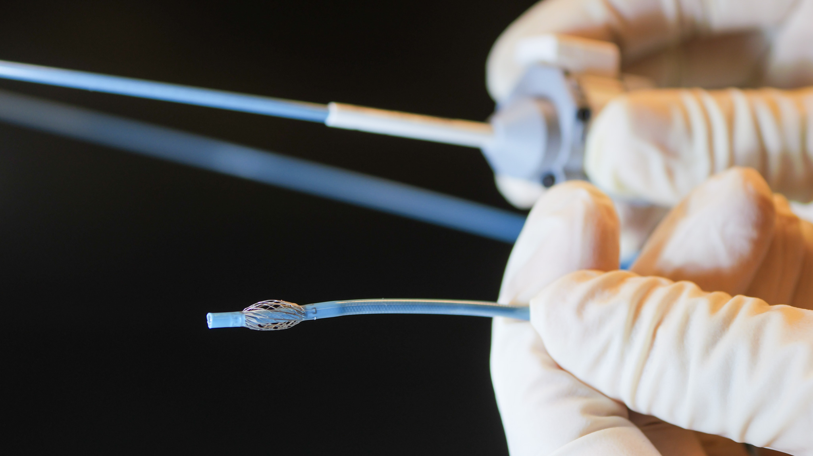
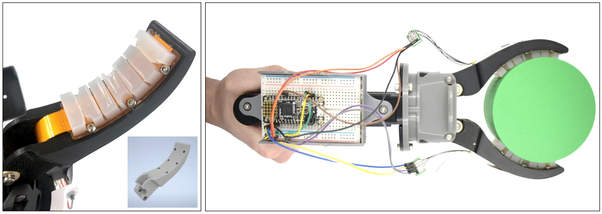
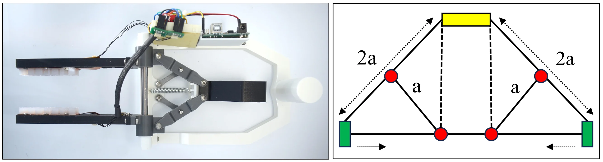
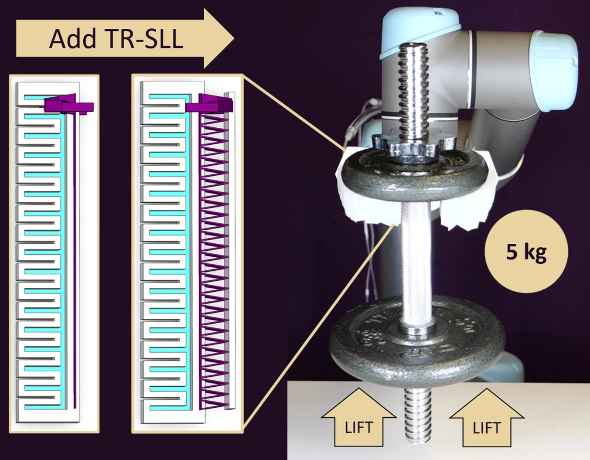

### Tip-transforming Guide Catheters based on Auxetic Metamaterials {toc-text="Tip-transforming Catheters"}

Coronary intervention requires physicians to thread a catheter through blood vessels to reopen the artery. Complex cases 
increase the risk of damaging the artery wall since forces pushing those devices past a blockage can drive the catheter out of position. 
HSAs proved to be effective in robotics due to their ability to expand radially when twisted. It helps
design catheters that can expand and anchor inside arteries to provide additional support and increased safety during the procedure. I am studying how the HSA's kinematics
and geometry affect its performance and mechanical properties, especially for millimeter-scale medical devices. This will help us build optimal designs for effective endo- and neurovascular therapies. 

Read more -- [Metamaterials meet Medicine](https://www.me.washington.edu/news/article/2025-12-15/metamaterials-meet-medicine){target="_blank"}.

::: funding
This work is supported by the National Institutes of Health (NIH), the Washington Research Foundation (WRF), and the National Science Foundation.
:::

::: {style="text-align: center; margin: 25px auto;"}
{fig-alt="Guide catheter with an expanded HSA." width=70% loading="lazy"}
:::

---

### Flexible Sensor-Integrated End Effector for Underwater Manipulation {toc-text="Underwater Manipulation"}

Underwater manipulation is challenging due to low visibility and turbulent conditions at depth, and mere visual feedback is
insufficient to assess grasp stability. Tactile sensors provide real-time contact pressure across the finger during subsea
manipulation, and can also be used to train slip detection classifiers to assist ROV operators. I built a
prototype based on [Reach Bravo's](https://reachrobotics.com/products/reach-bravo/reach-bravo-7){target="_blank"} end effector to integrate flexible tactile sensors.
We also developed a data collection procedure to perform slip characterization, simulating grasp conditions that occur during underwater grasping. Additionally,
I programmed a [PyVista](https://pyvista.org/){target="_blank"}-based visualizer that provides feedback on finger position, tracking its real-time state using a time-of-flight sensor.

Read: [IEEE Xplore](https://ieeexplore.ieee.org/document/11330401){target="_blank"}

::: funding
This work was supported by the Office of Naval Research (ONR), U.S. Department of Defense.
:::

::: {style="text-align: center; margin: 25px auto;"}
{fig-alt="Tactile sensors mounted on a Bravo end effector alongside a CAD rendering and prototype assembly" width=90% loading="lazy"}
:::

---

### Handed Shearing Auxetics (HSA) and High Grip Strength Soft Grippers {toc-text="Soft Gripper"}

Soft robots are ideal for delicate manipulation and safe human-robot interaction, but their lack of rigid structures limits real-world adoption. We developed a torsionally-rigid
strain limiting layer and integrated it into [handed shearing auxetics](https://www.science.org/doi/10.1126/science.aar4586){target="_blank"} (HSA)
to fabricate a soft gripper. I utilized finite element analysis to conduct a parametric design study and determine the optimal TR-SLL configuration.
This structure minimizes out-of-plane bending while preserving the gripper's in-plane compliance and flexibility.
The soft HSA gripper was able to lift a payload of over 1 kg (pinch grasp), and 5 kg when loaded through the TR-SLL element.
It reached a peak pinch force of 5.8 N, and a peak planar caging force of 14.5 N, a significant capacity when lifting objects perpendicular to gravity.
The gripper achieved a success rate of 86% when tested with 43 [YCB](https://ieeexplore.ieee.org/document/7251504){target="_blank"} objects.


Read: [IEEE Xplore](https://ieeexplore.ieee.org/abstract/document/11522819){target="_blank"} • [arXiv preprint](https://arxiv.org/abs/2412.07976){target="_blank"}

::: funding
This work was supported by the National Science Foundation, the Murdock Charitable Trust, and the Office of Naval Research (ONR).
:::

::: {style="margin: 30px auto; text-align: center;"}
```{=html}
<div style="width: 90%; aspect-ratio: 2.3 / 1.0; margin: 0 auto; overflow: hidden; border-radius: 5px;">
  <video src="assets/videos/hsa-gripper-ycb.mp4" poster="assets/videos/hsa-gripper-ycb-poster.webp" data-autoplay loop muted playsinline preload="metadata" style="display: block; width: 100%; height: 100%; object-fit: cover; object-position: center 48%;"></video>
</div>
```
<p class="figure-caption" style="margin-top: 10px;">Benchmarking robot grasping and manipulation</p>
:::

---

### Electrically-Driven Soft Arms based on Mechanical Metamaterials {toc-text="Soft Auxetic Arm"}

Expanding the work on HSA grippers, we designed and built an electrically-driven soft robot arm with auxetic metamaterials, including bendable, extendable,
and torsionally-rigid flex shafts. This arm does not require a hanging configuration to lift significant payloads. It can be mounted horizontally or vertically, and can perform
tasks such as pipe inspection and underwater docking with a high degree of compliance. The HSA arm lifted a 600 g mustard bottle while supporting its own weight, and up to 2.3 kg vertically.

Read: [arXiv preprint](https://arxiv.org/abs/2501.09819){target="_blank"}

::: funding
This work was supported by the Murdock Charitable Trust and the Office of Naval Research (ONR).
:::

::: {style="margin: 30px auto; text-align: center;"}
```{=html}
<div style="width: 90%; aspect-ratio: 2.15 / 1.0; margin: 0 auto; overflow: hidden; border-radius: 5px;">
  <video src="assets/videos/HSA-Arm-Lifting.mp4" poster="assets/videos/HSA-Arm-Lifting-poster.webp" data-autoplay loop muted playsinline preload="metadata" style="display: block; width: 100%; height: 100%; object-fit: cover; object-position: center 53%;"></video>
</div>
```
<p class="figure-caption" style="margin-top: 10px;"></p>
:::

---

### Sensing-Capable Parallel Jaw Gripper for Learning Soft Fruit Harvesting {toc-text="Learning Soft Fruit Picking"}

Harvesting soft fruits like blackberries requires precise grasp control — too much force damages the fruit, too little causes
it to slip. To study this, I built a sensorized parallel-jaw gripper integrated with tactile sensors, designed to work with
a blackberry proxy that is designed to simulate real fruit properties and variations. This low-cost, mechanically-operated gripper allows human-controlled data
collection, replicating soft fruit grasping conditions to train robots on detecting berry maturity and applying the correct
grasp pressure. Unlike conventional parallel-jaw grippers that rely on two independent motors and linear rails, this
design uses a mirrored [Scott-Russell linkage](https://en.wikipedia.org/wiki/Scott_Russell_linkage){target="_blank"} driven by a single linear actuator.
The mechanism used here lays the foundation to build an economical automated environment for training, though this remains
an open direction for future work.

Read: [IEEE Xplore](https://ieeexplore.ieee.org/abstract/document/11522859){target="_blank"}

::: funding
This work was supported by the National Science Foundation (NSF).
:::

::: {style="text-align: center; margin: 25px auto;"}
{fig-alt="Parallel-jaw gripper assembly and mirrored Scott-Russell linkage for actuation" width=90% loading="lazy"}
:::

---

### Enhanced Pneumatic Network Actuators (Pneu-Net) {toc-text="Enhanced Pneu-Net Actuators"}

This work introduced 3D-printed torsion-resistant strain limiting layers, which were then integrated into HSA grippers
(read above). Despite being the primary form of soft grippers, a key limitation to their wider adoption is
their inability to grasp significant payloads due to objects slipping out of grasps. They're primarily made up of silicone elastomers
and lack a rigid skeleton to counteract twisting forces. We overcame this limitation by introducing a torsionally-rigid strain limiting layer. TR-SLL reduced out-of-plane deformations
by up to 97% compared to a benchmark Pneu-Net actuator from the [Soft Robotics Toolkit](https://softroboticstoolkit.com/actuators){target="_blank"}.

Read: [IEEE Xplore](https://ieeexplore.ieee.org/document/10521982){target="_blank"} • [arXiv preprint](https://arxiv.org/abs/2311.02454){target="_blank"}

::: funding
This work was supported by the National Science Foundation (NSF), the Murdock Charitable Trust, and the Office of Naval Research (ONR).
:::

::: {.text-center}
{fig-alt="Torsion-resistant strain limiting layer helping a pneumatic network actuator lift a payload" fig-align="center" width=60% loading="lazy"}
:::

<p class="next-page"><a href="publications.html">Publications <span aria-hidden="true">→</span></a></p>

<style>
/* Justify on <main> (not a wrapper div): a div around the headings stops
   Quarto building the right-hand TOC. Centred figure/video divs override this by
   inheritance. Do NOT target `main p`, which drags figure images left. */
main { text-align: justify; hyphens: manual; }
main img { border-radius: 5px; }
.next-page { text-align: right; margin-top: 3rem; font-size: 1.1rem; }
</style>

<script>
// Sidebar short titles: each heading's {toc-text="..."} attribute is emitted by
// Pandoc as either toc-text or data-toc-text, on the section or the heading,
// depending on version. This rewrites TOC links from whichever is present.
// Edit the toc-text strings in the headings above to customize sidebar labels.
(function () {
  document.querySelectorAll(
    '#TOC a[href^="#"], nav[role="doc-toc"] a[href^="#"]'
  ).forEach(function (link) {
    var id = decodeURIComponent(link.getAttribute("href").slice(1));
    var target = document.getElementById(id);
    if (!target) return;
    var el = (target.hasAttribute("data-toc-text") || target.hasAttribute("toc-text"))
      ? target
      : target.querySelector("[data-toc-text], [toc-text]");
    if (!el) return;
    var short = el.getAttribute("data-toc-text") || el.getAttribute("toc-text");
    if (short) link.textContent = short;
  });
})();

// Loop-videos play only while on screen and only if motion is allowed;
// with reduced motion they stay on their poster frame.
(function () {
  var videos = document.querySelectorAll("video[data-autoplay]");
  if (!videos.length || !("IntersectionObserver" in window)) return;
  var reduced = window.matchMedia("(prefers-reduced-motion: reduce)");
  var io = new IntersectionObserver(function (entries) {
    entries.forEach(function (e) {
      if (e.isIntersecting && !reduced.matches) e.target.play().catch(function () {});
      else e.target.pause();
    });
  }, { threshold: 0.25 });
  videos.forEach(function (v) { io.observe(v); });
  reduced.addEventListener("change", function () {
    if (reduced.matches) videos.forEach(function (v) { v.pause(); });
  });
})();
</script>
