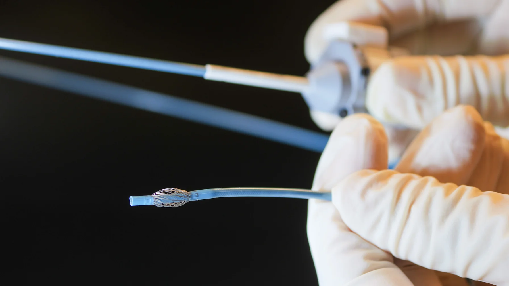
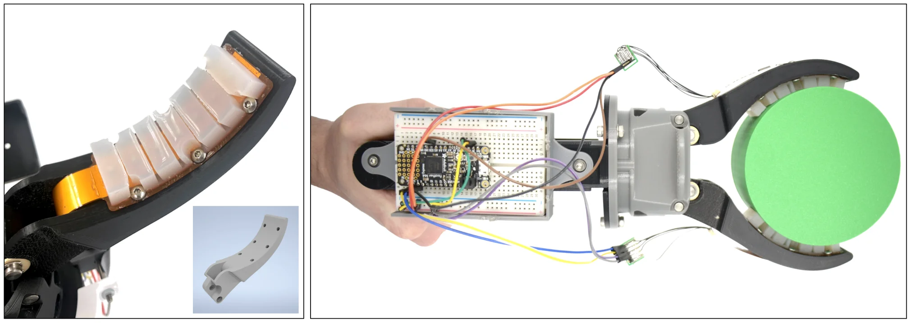
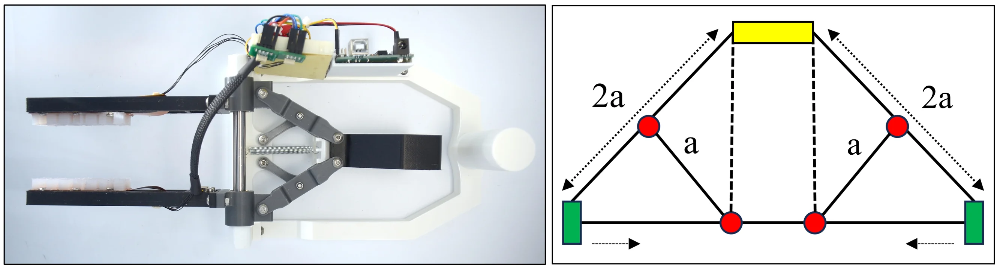
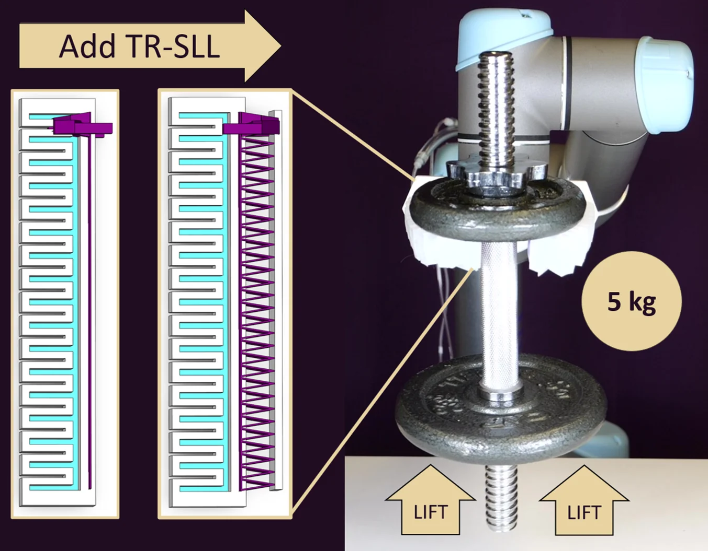

### Tip-transforming Guide Catheters based on Auxetic Metamaterials {toc-text="Tip-transforming Catheters"}

Coronary intervention and endovascular therapies require threading a catheter through blood vessels to reopen the artery. In complex [PCI](https://en.wikipedia.org/wiki/Percutaneous_coronary_intervention){target="_blank" rel="noopener"},
forces required to push devices past a blockage can drive the catheter out of its position, which can damage the artery wall or cause bleeding. To solve this, I help build catheters with transforming tips 
made of auxetic metamaterials. They have the ability to expand, bend, or extend, and can anchor inside arteries and provide stable support when needed during surgeries. I am building tools and studying how the kinematics
and geometry of the [HSA](https://www.science.org/doi/10.1126/science.aar4586){target="_blank" rel="noopener"} (that forms the tip) affect its mechanical behavior, especially for millimeter-scale medical devices. This will let us pick designs that are safe and effective for peripheral, endo- and neurovascular therapies.
In the future, this system can potentially enable autonomous anchoring.

Read more -- [Metamaterials meet Medicine](https://www.me.washington.edu/news/article/2025-12-15/metamaterials-meet-medicine){target="_blank" rel="noopener"}.

::: funding
This work is supported by the National Institutes of Health (NIH) and the Washington Research Foundation (WRF).
:::

::: {.media-figure}
{.ratio-catheter fig-alt="Guide catheter with an expanded HSA." width=95% loading="lazy"}
:::

---

### Flexible Sensor-Integrated End Effector for Underwater Manipulation {toc-text="Underwater Manipulation"}

Underwater manipulation is a challenging task due to low visibility and strong currents at depth, and mere visual feedback is
insufficient to assess grasp stability. Tactile sensing can complement vision and support human-supervised subsea
manipulation tasks. To demonstrate the use of flexible barometric tactile sensors on curved geometries, I developed an end-effector prototype which allowed gathering a large amount of data for supporting ROV-assisted operation. 
I co-developed a data collection procedure to characterize slip in the system that mimics the condition during underwater grasping. This can also be used to train slip detection classifiers so robots can make their decision.
Additionally, I developed tools that provide feedback on finger position that enhance user confidence. 

Read: [IEEE Xplore](https://ieeexplore.ieee.org/document/11330401){target="_blank" rel="noopener"}

::: funding
This work was supported by the Office of Naval Research (ONR), U.S. Department of Defense.
:::

::: {.media-figure}
{.ratio-bravo fig-alt="Tactile sensors mounted on a Bravo end effector alongside a CAD rendering and prototype assembly" width=90% loading="lazy"}
:::

---

### Handed Shearing Auxetics (HSA) and High Grip Strength Soft Grippers {toc-text="Soft Gripper"}

Soft robots are ideal for delicate manipulation and safe human-robot interaction, but their lack of rigid structures limits their use in real-world tasks. I integrated a torsionally-rigid
strain limiting layer (TR-SLL) into a [handed shearing auxetics](https://www.science.org/doi/10.1126/science.aar4586){target="_blank" rel="noopener"} (HSA)-based soft gripper. 
I conducted a finite element parametric design study to determine the optimal TR-SLL layout that minimized out-of-plane deformation without affecting the gripper's 
ability to bend in-plane. The soft HSA gripper was able to lift a payload of over 1 kg in a pinch grasp, and 5 kg when the load goes through the TR-SLL.
It reached a peak pinch force of 5.8 N, and a peak planar caging force of 14.5 N, which is substantial for lifting objects perpendicular to gravity.
The gripper achieved an 86% success rate when we tested with 43 [YCB](https://ieeexplore.ieee.org/document/7251504){target="_blank" rel="noopener"} objects.


Read: [IEEE Xplore](https://ieeexplore.ieee.org/abstract/document/11522819){target="_blank" rel="noopener"} • [arXiv preprint](https://arxiv.org/abs/2412.07976){target="_blank" rel="noopener"}

::: funding
This work was supported by the National Science Foundation, the Murdock Charitable Trust, and the Office of Naval Research (ONR).
:::

::: {.video-figure}
```{=html}
<div class="video-frame" style="aspect-ratio: 2.3 / 1;">
  <video class="cover-video" src="assets/videos/hsa-gripper-ycb.mp4" poster="assets/videos/hsa-gripper-ycb-poster.webp" width="1280" height="720" data-autoplay loop muted playsinline preload="metadata" style="object-position: center 48%;"></video>
</div>
```
<p class="figure-caption">Benchmarking robot grasping and manipulation</p>
:::

---

### Sensing-Capable Parallel Jaw Gripper for Learning Soft Fruit Harvesting {toc-text="Learning Soft Fruit Picking"}

Fresh blackberries are still picked by hand, and growers struggle to find enough workers every season. Robots could help, but harvesting soft fruits like blackberries requires careful force control. 
Too much force damages the fruit, too little causes it to slip. To teach robots, I built a sensorized parallel-jaw gripper integrated with tactile sensors that works with
a blackberry proxy that is designed to simulate real fruit properties and variations. This gripper allows human-controlled data
collection to train robots that can judge berry ripeness and apply the right grasp pressure. Most parallel-jaw grippers rely on two independent motors and linear rails, while this
design uses a mirrored [Scott-Russell linkage](https://en.wikipedia.org/wiki/Scott_Russell_linkage){target="_blank" rel="noopener"} driven by a single linear actuator.
This mechanism could be used to build an automated, affordable training platform, though this remains an open direction for future work.

Read: [IEEE Xplore](https://ieeexplore.ieee.org/abstract/document/11522859){target="_blank" rel="noopener"}

::: funding
This work was supported by the National Science Foundation (NSF).
:::

::: {.media-figure}
{.ratio-parallel-jaw fig-alt="Parallel-jaw gripper assembly and mirrored Scott-Russell linkage for actuation" width=90% loading="lazy"}
:::

---

### Electrically-Driven Soft Arms based on Mechanical Metamaterials {toc-text="Soft Auxetic Arm"}

Soft robot arms usually require a hanging configuration to lift significant payloads. Expanding the work on HSA grippers, we designed and built an electrically-driven soft arm with auxetic metamaterials,
and flex shafts that bend and extend while transmitting torque through the system. This arm can be mounted horizontally or vertically, and can perform
tasks such as pipe inspection and underwater docking with a high degree of compliance. The HSA arm lifted a 603 g mustard bottle while supporting its own weight, and up to 2.3 kg vertically.

Read: [arXiv preprint](https://arxiv.org/abs/2501.09819){target="_blank" rel="noopener"}

::: funding
This work was supported by the Murdock Charitable Trust and the Office of Naval Research (ONR).
:::

::: {.video-figure}
```{=html}
<div class="video-frame" style="aspect-ratio: 2.15 / 1;">
  <video class="cover-video" src="assets/videos/HSA-Arm-Lifting.mp4" poster="assets/videos/HSA-Arm-Lifting-poster.webp" width="1280" height="720" data-autoplay loop muted playsinline preload="metadata" style="object-position: center 53%;"></video>
</div>
```
:::

---

### Enhanced Pneumatic Network Actuators (Pneu-Net) {toc-text="Enhanced Pneu-Net Actuators"}

Pneu-Nets are the most common form of soft gripper, but they are made usually of silicone with no skeleton to resist twisting. So objects that are being picked slip out of the grasp under heavier loads. 
We introduced the 3D-printed torsion-resistant strain limiting layers to this system, which reduced out-of-plane deformations
by up to 97% compared to a benchmark Pneu-Net actuator from the [Soft Robotics Toolkit](https://softroboticstoolkit.com/actuators){target="_blank" rel="noopener"}. We later carried this over to the HSA gripper above.


Read: [IEEE Xplore](https://ieeexplore.ieee.org/document/10521982){target="_blank" rel="noopener"} • [arXiv preprint](https://arxiv.org/abs/2311.02454){target="_blank" rel="noopener"}

::: funding
This work was supported by the National Science Foundation (NSF), the Murdock Charitable Trust, and the Office of Naval Research (ONR).
:::

::: {.text-center}
{.ratio-tr-sll fig-alt="Torsion-resistant strain limiting layer helping a pneumatic network actuator lift a payload" fig-align="center" width=60% loading="lazy"}
:::

<p class="next-page"><a href="publications.html">Publications <span aria-hidden="true">→</span></a></p>

<style>
/* Justify on <main> (not a wrapper div): a div around the headings stops
   Quarto building the right-hand TOC. Centred figure/video divs override this by
   inheritance. Do NOT target `main p`, which drags figure images left. */
main { text-align: justify; hyphens: manual; }
main img { border-radius: 5px; }
.next-page { text-align: right; margin-top: 3rem; font-size: 1.1rem; }

/* Centred figure blocks; videos get a little more space around them. */
.media-figure, .video-figure { text-align: center; }
.media-figure { margin: 25px auto; }
.video-figure { margin: 30px auto; }
.video-figure .figure-caption { margin-top: 10px; }

/* Video box: 90% wide with rounded corners. Each video sets its own
   aspect-ratio (box shape) and object-position (which part stays in view). */
.video-frame { width: 90%; margin: 0 auto; overflow: hidden; border-radius: 5px; }

/* Each image's real width / height, so the page keeps its space while the image
   loads and nothing below it jumps. Update the numbers if you replace an image. */
.ratio-catheter     { aspect-ratio: auto 1792 / 1008; }
.ratio-bravo        { aspect-ratio: auto 2019 / 720; }
.ratio-parallel-jaw { aspect-ratio: auto 2667 / 720; }
.ratio-tr-sll       { aspect-ratio: auto 1353 / 1055; }
</style>

<script>
// Short sidebar labels: Quarto copies each heading's {toc-text="..."} onto its
// <section> as data-toc-text; use it as the link text in the right-hand TOC.
document.querySelectorAll('#TOC a[href^="#"]').forEach((link) => {
  const section = document.getElementById(decodeURIComponent(link.getAttribute('href').slice(1)));
  const label = section?.dataset.tocText;
  if (label) link.textContent = label;
});
</script>
